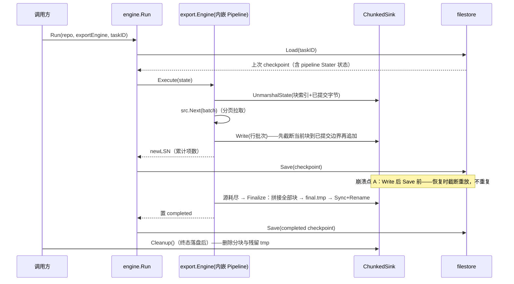
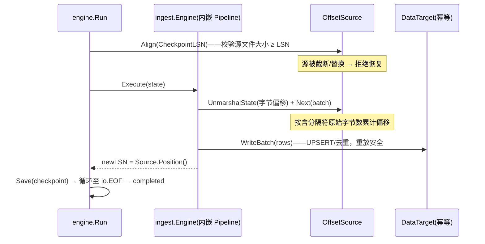
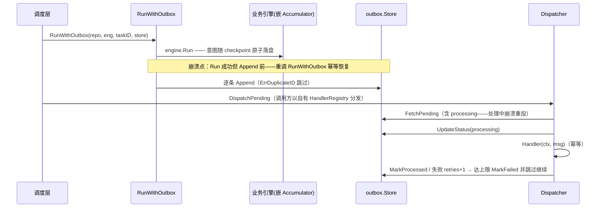
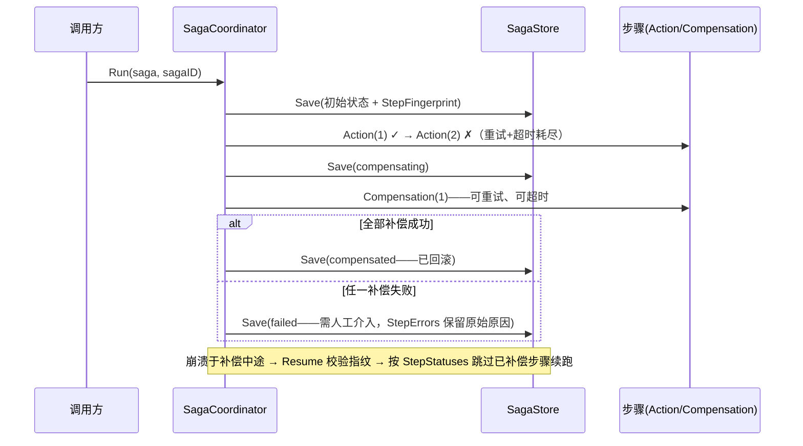

# waypoint 通用 Checkpoint 工具包设计规格

- **配套文档**: [adr.md](adr.md)（架构决策记录）、[checklists.md](checklists.md)（待确认与疑点清单）

---

## 1. 概述

`waypoint` 是为长时间运行的异步任务提供 **checkpoint / resume** 能力的纯 Go 库（Go 1.26+，零外部依赖，仅标准库）。调用方只需描述「一步做什么」，框架负责初始化、原子持久化、崩溃恢复编排与进程内重试。

适用场景：ETL 流水线、数据同步、批处理等一切「可分步推进且需中断恢复」的任务。

### 能力范围

| 机制 | 一句话定位 |
|---|---|
| 状态模型与持久化契约 | 任务状态的原子持久化抽象与文件后端 |
| Checkpoint 引擎编排 | 通用主循环：Load → 对齐 → Execute → Save |
| 批次管道原语 | 「取一批 → 写一批 → 落 checkpoint」的泛型管道 |
| 库内文件管道组件 | 分块文件汇、偏移行源两个可复用文件组件 |
| 数据管道扩展包 | 导出/导入垂直引擎（独立扩展包，非库 API） |
| Outbox 模式 | 不可逆操作的 at-least-once 分发 |
| Saga 模式 | 多步补偿事务 |

**不可逆操作（发邮件、扣款、消息队列发送）不得在引擎 Execute 内直接执行**——经 outbox / saga 在调度层处理。

### 非能力（详见第 9 章）

任务调度器、定时器、并发 goroutine 池、HTTP/gRPC 服务层、多实例互斥。

---

## 2. 总体架构

### 2.1 包结构

```
waypoint/                          # 核心库（单一 module）
├── waypoint/                  # 便捷调用糖（组合边界）：Task 世系句柄（ADR-10）
├── state/                     # 领域模型：Phase / LSN / BaseTaskState / StateRepository / 哨兵错误
├── engine/                    # 通用编排：Engine + PhaseSet + Run() + WithRetry
├── stream/                    # 批次管道原语：Source / Sink / Pipeline
│   ├── ChunkedSink            # 库内组件：分块文件汇（截断重放 + 原子合并）
│   └── OffsetSource           # 库内组件：偏移行源（含分隔符字节计数）
├── internal/atomicfile/       # 原子写原语（全库唯一 tmp→Sync→Rename 实现）
├── filestore/                 # StateRepository 文件后端
├── outbox/                    # 调度层 outbox 模式
│   ├── filestore/             # outbox Store 文件后端
│   └── producer/              # 生产引擎骨架（ADR-12）
└── saga/                      # 调度层 saga 模式

datapipeline/                  # 扩展包（独立分发，核心不依赖）
├── export/                    # 导出垂直引擎：分页源 + ChunkedSink
└── ingest/                    # 导入垂直引擎：OffsetSource + 幂等目标
```

### 2.2 依赖方向

```
datapipeline（扩展包）
   │ 依赖核心，组合 Pipeline 与库内文件组件为 engine.Engine
   ▼
engine ←── stream          outbox / saga（调度层，独立状态机不依赖 engine）
   │         │             例外：outbox.RunWithOutbox 桥接 engine 与 state（§5.6）
   └────┬────┘
        ▼
      state
        ▼
internal/atomicfile ←── filestore / outbox.filestore（共用唯一原子写原语）
```

- `engine` 只依赖 `state`。
- `stream` 依赖 `engine`/`state`（`Pipeline` 提供引擎骨架，由适配引擎组合）。
- `outbox` / `saga` 是独立状态机，不依赖 `engine`；与引擎的组合由调用方完成，outbox 另提供桥接入口 `RunWithOutbox`（依赖 `engine` 与 `state`，见 §5.6）与生产引擎骨架 `outbox/producer`（组合 `engine`，见 §5.8、ADR-12）。
- 根包 `waypoint` 是组合边界（ADR-10）：依赖 `engine`/`filestore`/`outbox`/`state`，仅做既有调用的顺序转发（糖），无业务逻辑、无自有状态类型以外的概念。
- `datapipeline` 依赖核心包，核心包不得反向依赖它。

### 2.3 设计原则

1. **最小公共 API**：全部能力收敛为一个引擎契约、一个管道原语、两个调度层模式。
2. **阶段词汇表数据驱动**：核心只定义协议级阶段；业务阶段由引擎在 `PhaseSet` 中声明，框架零硬编码。
3. **能力用可选接口扩展**：对齐、进度、收尾、状态持久化均为可选接口，类型断言探测；不要求组件实现空方法。
4. **LSN 不解释语义**：框架只透传不透明 `int64`，对齐语义由业务侧定义。
5. **原子写全库唯一实现**：一切持久化组件复用 `internal/atomicfile`，不得私写临时文件逻辑。
6. **一概念一名**：回调签名跨包一致（全部携带 `context.Context`）；错误前缀 = 包名；禁止同名包。
7. **零死值**：模型中的每个字段与枚举值必须有明确写入方与消费方。

### 2.4 并发模型

库不创建、不调度 goroutine——一切执行都在调用方的 goroutine 内同步推进（唯一例外：`Dispatcher.Start` 的后台轮询便利模式）。起多少个 goroutine、何时取消，全由调用方决定；`context.Context` 是唯一控制面。

并发安全不靠锁协调，靠**隔离 + 单写者前提**：

| 前提 | 含义 |
|---|---|
| 单任务单执行器 | 同一 taskID 同时至多一个 `Run` 在推进——两个 Run 交错 Execute/Save 会破坏 checkpoint 一致性 |
| 单 saga 单协调器 | 同一 sagaID 同时至多一个协调器实例在推进 |
| 单分发器 | 同一 Store 同时至多一个 Dispatcher（ADR-6） |

各场景的并发形态：

| 场景 | 形态 |
|---|---|
| 多任务并行 | 每任务一个 goroutine + 一个引擎实例 + 一个 taskID；状态按 taskID 隔离、互不共享，无需任何协调 |
| 单任务执行 | `Run` 阻塞调用；管道（Pipeline/Source/Sink）在 Run 的 goroutine 内同步执行 |
| outbox 生产 | Accumulator 随引擎在任务 goroutine 内收集，无并发 |
| outbox 消费 | `DispatchPending` 同步调用，或 `Start` 单后台 goroutine；Store 须支持 Append 与 FetchPending 并发（§5.6） |
| saga | 协调器同步执行；多个不同 saga 各自独立并行 |
| 停止 | ctx 取消传播至一切阻塞回调（含 Handler/Action/Compensation）；无内部池需要排空 |

「不做调度」排除的是：定时触发、优先级排队、限流、池化与重排队——由调用方或上层系统承担。

---

## 3. 核心数据模型

```go
package state

// Phase 是异步任务的生命周期阶段。
// 字符串值保持稳定——它们会被持久化到 checkpoint 中。
type Phase string

// 协议级常量，构成默认生命周期：pending → running → completed / failed。
// 业务阶段由引擎在 PhaseSet 中声明，不作为核心包常量。
const (
    PhasePending   Phase = "pending"
    PhaseRunning   Phase = "running"
    PhaseCompleted Phase = "completed"
    PhaseFailed    Phase = "failed"
)

// LSN 是不透明的进度偏移量（int64 覆盖文件字节、行号、DB WAL LSN、时间戳等场景）。
// 框架只透传、不解释。
type LSN = int64

// BaseTaskState 是公共状态字段，业务状态经 Payload 扩展。
type BaseTaskState struct {
    TaskID        string          `json:"task_id"`
    TaskType      string          `json:"task_type"`
    Phase         Phase           `json:"phase"`
    Message       string          `json:"message,omitempty"` // 失败原因 / 进度描述
    Progress      int             `json:"progress"`          // 0-100
    CheckpointLSN LSN             `json:"checkpoint_lsn"`
    Payload       json.RawMessage `json:"payload"`
}

// StateRepository 是任务状态的原子持久化抽象。
type StateRepository interface {
    // Load 加载状态；任务不存在返回 (nil, nil)，不是 error。
    Load(ctx context.Context, taskID string) ([]byte, error)
    // Save 原子全量替换；返回 nil 表示已完整持久化，不允许部分合并。
    Save(ctx context.Context, taskID string, state []byte) error
    // Delete 幂等；删除不存在的任务不报错。
    Delete(ctx context.Context, taskID string) error
}

var (
    ErrSaveFailed = errors.New("waypoint/state: save failed")
    ErrLoadFailed = errors.New("waypoint/state: load failed")
)
```

### Payload 命名空间

`Payload` 顶层是命名字段空间，各参与方自持子块、可组合共存：

```json
{ "pipeline": { "count": <累计已处理项数>, "src": <Source 状态>, "sink": <Sink 状态> }, "outbox": [ <消息…> ] }
```

各命名空间子块（`json.RawMessage`）由各参与方自持装配——框架核心不提供通用合并助手：`pipeline` 由 Pipeline 自持（还原/持久化），`outbox` 由 `outbox.Collector` 自持（ADR-11），业务子块由组合引擎负责。`pipeline.count` 由 Pipeline 自身维护：无 Positioner 的管道以它作为 LSN（配对规则第 3 条的回退），随 checkpoint 原子保存。

---

## 4. 技术底座简介

工具包依赖三个操作系统/语言级前提：

1. **`os.Rename` 在同一文件系统内原子**——「写临时文件 → Sync → Rename」使目标文件要么完整出现、要么完全不出现；中途崩溃只残留临时文件。
2. **目录项不保证随文件 fsync 落盘**——掉电场景需对父目录额外 fsync（POSIX `open`+`fsync`；Windows 目录句柄 `FlushFileBuffers`），因此掉电安全作为可选项而非默认（见 §5.1）。
3. **`context.Context` 取消传播与 `errors.Is`/`errors.Join` 判别**——一切阻塞回调接收 ctx；类别哨兵与根因可同时挂载在同一错误值上。

```
调用方 ──ctx──▶ 引擎/管道/调度层 ──ctx──▶ 物理系统（文件/DB/外部服务）
   ▲                                    │
   └────────── checkpoint（原子写）◀─────┘
```

---

## 5. 能力机制设计

### 5.1 状态模型与持久化契约（含文件后端）

**动机**：任务可恢复的前提是状态与物理副作用有一致的落盘边界；持久化逻辑若各自为政，崩溃窗口语义不可推理。

**方案**：

- 契约见第 3 章：`Load` 缺失返回 `(nil, nil)`、`Save` 原子全量替换、`Delete` 幂等。
- 原子写原语 `internal/atomicfile`：`tmp → Sync → Rename`，全库唯一实现；`filestore` 与 `outbox/filestore` 均复用。
- 文件后端 `filestore.FileRepository`：

```go
func New(dir string) (*FileRepository, error)  // MkdirAll 0755；构造时清理崩溃残留 *.state.tmp
// 文件命名：<taskID>.state / <taskID>.state.tmp
```

- 持久化语义分级：
  - **进程崩溃安全（默认保证）**：`tmp → Sync → Rename`；构造入口自动清理残留 tmp。
  - **掉电安全（可选，默认关闭）**：Rename 后对父目录 fsync，由部署方决定启用。
- 错误包装：哨兵与底层根因同时保留——

```go
return fmt.Errorf("filestore: save %s: %w", taskID, errors.Join(state.ErrSaveFailed, err))
// errors.Is(err, state.ErrSaveFailed) 与 errors.Is(err, os.ErrPermission) 均可达
```

**不变量**：

1. 磁盘上任意时刻不存在「半写的正式文件」。
2. 每个哨兵错误至少被一条 `errors.Is` 测试锁定判别性。
3. 幂等方法（`Delete` 等）只把「目标不存在」视为成功；IO 故障必须返回错误。
4. `taskID` 与 outbox 消息 ID 必须是文件系统安全字符串（不含路径分隔符等）；文件后端写入前校验，非法即报错。

**失败模式**：写 tmp 失败 / Sync 失败 / Rename 失败 → 删除 tmp、返回「哨兵 ∪ 根因」错误；掉电（未启用目录 fsync）→ 最新 checkpoint 可能丢失，任务从上一 checkpoint 恢复。

> 交叉引用：ADR-2（原子写唯一实现）。

### 5.2 Checkpoint 引擎编排

**动机**：相似任务共享同一「Load → 对齐 → Execute → Save」循环骨架；把骨架收敛进框架，加阶段 = 声明数据，不是改框架。

**方案**：

```go
package engine

type PhaseSet struct {
    All         []state.Phase // 全部合法阶段
    Initial     state.Phase   // 新任务初始阶段；零值 = PhasePending
    Recoverable []state.Phase // 恢复时需要对齐（Align）的阶段
    Terminal    []state.Phase // 终态；Run 达到后停止循环
}

// 判定辅助：框架与调用方共用同一判定来源，不得各自遍历集合实现。
func (ps PhaseSet) IsTerminal(p state.Phase) bool
func (ps PhaseSet) IsRecoverable(p state.Phase) bool

type Engine interface {
    TaskType() string
    Phases() PhaseSet
    // Execute 执行一步业务逻辑并返回新 LSN。
    // 时序契约：先产生物理副作用，框架后保存 checkpoint；崩溃时物理系统可能
    // 领先于 checkpoint，恢复路径由 Aligner 对齐。
    // 重入契约：Execute 的副作用必须可安全重放（幂等）或可对齐——已在 Execute
    // 产生但未 checkpoint 的副作用，重试/恢复时重放不得累积。
    Execute(ctx context.Context, s *state.BaseTaskState) (state.LSN, error)
}

// 可选接口：无此能力的引擎不实现，不留空方法。
type Aligner interface    { Align(ctx context.Context, targetLSN state.LSN) error }
type Progressor interface { Progress(s state.BaseTaskState) int } // 0-100

// Run 成功返回最终已保存状态（失败返回 nil, err）——桥接与调用方无需二次 Load。
func Run(ctx context.Context, repo state.StateRepository, eng Engine, taskID string, opts ...RunOption) (*state.BaseTaskState, error)
func WithRetry(maxRetries int, delay time.Duration) RunOption // 仅作用于 Execute；负值参数构造时 panic
```

**PhaseSet 校验清单**（`Run` 进入循环前强制，不满足即返回错误）：

1. `All` 非空；`Initial ∈ All`（零值视作 `PhasePending`）；`Initial ∉ Terminal`。
2. `Recoverable ⊆ All`、`Terminal ⊆ All`。
3. `PhaseFailed ∈ All` 时必须 `PhaseFailed ∈ Terminal`（否则引擎置 failed 后循环不结束）。

`Recoverable` 与 `Terminal` 允许重叠，恢复判定时终态优先——终态任务不触发 Align（主循环第 3 步，非校验错误）。

**Run 主循环语义**：

1. 校验 `Phases()`。
2. `Load`：`nil` → 以 `Initial` 初始化；否则反序列化并校验 `Phase ∈ All` **且 `TaskType` 匹配**（防止用错引擎恢复旧状态）。
3. 恢复：`Phase ∈ Recoverable` 且 `Phase ∉ Terminal` 且引擎实现 `Aligner` → `Align(ctx, CheckpointLSN)`。此步先于任何 `Stater` 还原；`Aligner` 不得依赖 `Stater` 内容（需要分块/偏移元数据才能对齐的引擎，必须把该信息可逆编码进 LSN）。
4. 循环直到 `Phase ∈ Terminal`：
   - **快照**：深拷贝整个 `BaseTaskState`（含 Payload 字节）。
   - `Execute` → 返回 error 时**回滚到快照**再按 `WithRetry` 重试；重试耗尽返回该 error，**不落盘**。
   - 成功后校验 `Phase ∈ All`（引擎不得写入未知阶段）→ `CheckpointLSN = newLSN` → 若实现 `Progressor` 写入 `Progress` → **无条件 Save**。
5. **失败语义（优雅失败）**：
   - 引擎在 `Execute` 内置 `PhaseFailed` 并返回 `nil` → 框架 Save 后停止（`failed ∈ Terminal`），失败原因写入 `Message`。这是**唯一落盘的失败路径**。
   - `Execute` 返回非 nil error = 可重试/可恢复：重试耗尽后 `Run` 返回 error 不落盘，任务停留于最后已提交阶段，下次 `Run` 从该阶段恢复。
   - 框架不兜底写终态；持久化的 `failed` 只能来自引擎显式判定，由此「未完成」与「失败告终」天然可区分。
6. ctx 取消：返回 `ctx.Err()`，不落盘；任务停留于最后已提交阶段，下次 `Run` 恢复。

**不变量**：

1. 每次 `Execute` 成功返回 nil 后必有一次 Save；仅当 `Phase ∈ Terminal` 时结束循环。
2. 失败调用的部分状态修改不得泄漏进重试（快照回滚保证）。
3. `Load`/`Save`/`Align` 错误不重试，直接返回。
4. 单任务单执行器前提（§2.4）：同一 taskID 同时至多一个 Run；引擎实例默认每任务独立，声明并发安全者除外。

**失败模式**：引擎不推进 Phase → 死循环（PhaseSet 校验 + 文档声明转出义务）；恢复时 TaskType 不匹配 / 未知 Phase → 拒绝恢复并返回错误；Save 失败 → 返回错误，物理副作用可能领先于 checkpoint，由下次恢复的 Align 对齐。

> 交叉引用：ADR-1（终态归属）、ADR-5（重试快照）。

### 5.3 批次管道原语 `stream`

**动机**：「分页拉取 → 写文件」与「读文件 → 批量入库」拥有相同循环骨架「取一批 → 写一批 → 落 checkpoint 位置」；统一为一个泛型原语后，新管道只需一对薄适配器。

**方案**：

```go
type Source[Item any] interface {
    // Next 产出下一批。最后一批允许与 io.EOF 同次返回（items 非空 + io.EOF），
    // 管道先处理本批再终止；源彻底耗尽后返回 (nil, io.EOF)。
    Next(ctx context.Context, batchSize int) ([]Item, error)
}

type Sink[Item any] interface {
    // Write 写入一批。必须幂等——崩溃恢复会重放同一批。
    Write(ctx context.Context, items []Item) error
}

// 可选接口
type Positioner interface { Position() int64 }  // 已提交物理边界
type Sizer interface      { Size() int64 }       // 总量估计（进度）
type Stater interface {
    // 源/汇自身的持久化状态（分页游标、分块进度、字节偏移）。
    // UnmarshalState 必须把源/汇完全回退到上次已提交状态（全量还原，非增量）
    // ——进程内重试复用同一对象，增量还原会导致重放重复。
    MarshalState() (json.RawMessage, error)
    UnmarshalState(data json.RawMessage) error
}
type Finalizer interface { Finalize(ctx context.Context) error } // 源耗尽后的收尾

type Pipeline[Item any] struct{ /* src, sink, batchSize */ }
func New[Item any](src Source[Item], sink Sink[Item], opts ...Option[Item]) *Pipeline[Item]
func WithBatchSize[Item any](n int) Option[Item]

// AsEngine 以指定 TaskType 包装为 engine.Engine——适配引擎免写转发样板；
// 需要追加业务逻辑（如行编码）时仍可内嵌 Pipeline 自行实现。
func (p *Pipeline[Item]) AsEngine(taskType string) engine.Engine
```

对齐能力复用 `engine.Aligner`（同一接口，不在 `stream` 重复声明）。

**补偿侧配对不变量（正确性根基）**：

1. 只有作为物理补偿目标的一侧才允许实现 `Positioner`，且该侧必须同时实现 `engine.Aligner`。
2. `Sink` 与 `Source` 不得同时实现 `Positioner`。
3. 两侧都无 `Aligner` 时，回退「累计已处理项数」作为 LSN 才是合法的。

**每步成功 Write 后的 LSN**：

```
LSN = Sink.Position()      // 汇是补偿侧（如输出文件字节）
否则 = Source.Position()   // 源是补偿侧（如源文件字节偏移）
否则 = 累计已处理项数       // 两侧皆无物理位置（纯变换管道 / 截断重放型分块管道）
```

`Position()` 在 `Write` 之后调用，反映已提交物理边界——恢复时 `Align(targetLSN)` 把物理系统截回该边界，无需前滚。

**Pipeline.Execute 语义**（引擎骨架，适配引擎内嵌并转发）：

1. `PhasePending` → 置 `PhaseRunning`，返回 0（零偏移，无进度）。
2. 从 `state.Payload` 的 `pipeline` 命名空间还原源/汇 `Stater` 状态与 `count`（累计项数）。
3. `src.Next(batchSize)`：`io.EOF` → 若 sink 实现 `Finalizer` 先 `Finalize`，成功后置 `PhaseCompleted`；其他错误 → 返回（最后一批 items 非空 + io.EOF 时先处理本批再终止）。
4. `sink.Write(items)` → 持久化源/汇 `Stater` 状态与递增后的 `count` → 按配对规则计算 LSN 返回（有 Positioner 用 `Position()`，否则用 `count`）。

`Phases()` 默认 `DefaultPhaseSet()`；`Progress()` 在有 `Positioner + Sizer` 时按 position/size 估算，适配引擎可覆写。

**不变量**：Stater 状态与 checkpoint 原子一致（同一次 Save）；`Finalize` 不得删除重放输入；进度不得伪造（无 Sizer 时可为 0）。

**失败模式**：Write 后 Save 前崩溃 → 恢复时 Align 截断 + Stater 回滚，重放同一批不重复；`Finalize` 后 completed Save 前崩溃 → 重放 Finalize（幂等：重新拼接 + Rename）；Stater 增量还原 → 重放重复（由全量还原契约禁止）。

> 交叉引用：ADR-8（通用文件能力下沉）。

### 5.4 库内文件管道组件

**动机**：分块写文件、截断重放、偏移行读取、原子合并是跨业务可复用的机制，属于库；把它们留在参考示例里会让每个调用方重造并各自引入崩溃窗口缺陷。

#### 5.4.1 分块文件汇 `ChunkedSink`

```go
package stream

// ChunkedSink 把批次逐行写入编号分块临时文件，收尾时原子合并为最终文件。
// 实现 Sink[[]byte]（每项一行，追加行尾符）、Stater、Finalizer。
// 项为原始行字节（不含行尾符）——行编码（JSON/CSV 等）由 Source 适配层完成，
// 汇只做字节追加，不解释内容。
func NewChunkedSink(dir, finalName string, opts ...ChunkedSinkOption) *ChunkedSink
// ChunkedSinkOption:
//   WithBatchesPerChunk(n int)   // 每块包含的批数，默认 10
//   WithLineSuffix(s []byte)     // 行尾符，默认 '\n'
//   WithFilePerm(0644)

// 分块命名：<finalName>.chunk_<N>.tmp；合并临时文件：<finalName>.final.tmp
// Stater 状态：{ "chunk_idx": int, "committed_bytes": int64 }（当前块）
```

- **截断重放不变量**：`Write` 打开当前分块时，先截断到 Stater 记录的已提交字节边界，再追加本批——「上次 Execute 已写但未 checkpoint」的多余字节被消除，重放不重复、不乱序。（等价替代：每批写独立临时文件后原子覆盖，二选一实现。）
- **`Finalize`**：按块序拼接全部分块至 `<finalName>.final.tmp`，`Sync + Rename` 为最终文件——最终产物原子出现；**不得删除分块**（分块是重放输入）。
- **`Cleanup() error`**：删除全部分块与残留 `.final.tmp`。**必须在 completed checkpoint Save 成功之后由调用方显式调用**；返回 error，目录读取与删除失败必须可见。
- LSN：分块模式下汇无 `Positioner`/`Aligner`（重放由截断保证安全），管道 LSN 回退「累计已处理项数」，块进度由 Stater 承载。
- **一产物路径一世系**：分块与最终文件名均由 `outputPath` 派生，同一 `outputPath` 同一时刻只归属一个 taskID 世系；多世系共享/交错使用同一输出路径会互相覆盖，属调用方违约（指纹拦不住各自的自洽绑定）。

**失败模式**：块写到一半崩溃 → 恢复重放截断到已提交边界；Finalize 中途崩溃 → 只残留 tmp，已 Rename 的最终文件绝不被破坏；调用方在终态 Save 前误调 Cleanup → 分块丢失、completed 无法重放（协议规定调用顺序，Cleanup 前置属调用方违约）。

> 交叉引用：ADR-8（能力下沉）、ADR-3（清理责任与错误可见性）。

#### 5.4.2 偏移行源 `OffsetSource`

```go
package stream

// OffsetSource 按字节偏移逐行读取文本文件（JSONL 等），断点续读。
// 实现 Source[[]byte]（返回不含行尾符的原始行）、Stater（字节偏移）、
// Positioner（偏移）、Aligner（源侧补偿）。
func NewOffsetSource(path string) *OffsetSource
```

- **字节偏移按包含行分隔符的原始字节数累计**——读取必须使用「返回原始字节（含分隔符）」的按行读取（如 `bufio.Reader.ReadBytes('\n')`）；禁止使用会剥离行尾符/`\r` 的行扫描器计算断点偏移。兼容 `\n`、`\r\n`、末行无换行。
- **`Align(targetLSN)`（源侧补偿）**：校验源文件大小 ≥ LSN，小于则返回错误拒绝恢复（源文件可能被截断/替换）。
- 管道 LSN = `Source.Position()`（源是补偿侧）；批量行解码失败由适配层的 Sink/调用方处理。

**失败模式**：源文件在任务中途被截断 → Align 拒绝恢复并报错；偏移按剥离分隔符计数 → 断点错位、重放重复/跳行（由上述读取契约禁止）。

> 交叉引用：ADR-8（能力下沉）。

### 5.5 数据管道扩展包 `datapipeline`

**动机**：分页导出、幂等入库是垂直业务编排；进核心库会重新把业务词汇焊进框架。以独立扩展包分发：依赖核心、核心不依赖它、独立版本演进。

**方案**：

```go
package datapipeline

type Row = map[string]any

// DataSource 分页数据源（DB 查询 / API）。page 从 0 起；io.EOF 表示耗尽。
type DataSource interface { FetchPage(ctx context.Context, page, pageSize int) ([]Row, error) }

// DataTarget 幂等写入目标（UPSERT / 去重）——重放同一批安全。
type DataTarget interface { WriteBatch(ctx context.Context, rows []Row) (inserted int64, err error) }
```

```go
package export // datapipeline/export

// Engine 组合「分页 Source 适配（页游标经 Stater 持久化，行编码在此完成）
// + stream.ChunkedSink」。
// TaskType = "export"；Phases() = engine.DefaultPhaseSet()——合并收尾经 Finalizer
// 在源耗尽时完成，无需声明中间业务阶段。
func New(src DataSource, outputPath string, opts ...Option) *Engine
// Option: WithPageSize(1000) / WithBatchesPerChunk / WithRowMarshaler(func(Row) ([]byte, error))
// 分块与最终文件名均以 outputPath 为前缀派生。
func (e *Engine) Cleanup() error // 转发 ChunkedSink.Cleanup；终态 checkpoint 保存之后由调用方调用
```

```go
package ingest // datapipeline/ingest

// Engine 组合「stream.OffsetSource + DataTarget 适配的幂等 Sink」。
// TaskType = "ingest"。
func New(srcPath string, target DataTarget, opts ...Option) *Engine
// Option: WithBatchSize(1000) / WithRowUnmarshaler(func([]byte) (Row, error))
```

命名纪律：包名 = TaskType = 概念名（`export` / `ingest`），导出/导入全链路一名。

**绑定指纹（ADR-10）**：各垂直引擎在 Payload 的自持命名空间（`"export"` / `"ingest"` 键）维护绑定指纹（SHA-256 over 各自的产物路径 / 源文件路径），防止同 taskID 换绑定恢复：

- **首个 checkpoint 必须携带**：wrapper 在 pending→running 步（`Pipeline.Execute` 的提前返回步）也写入指纹，否则「crash 于首个 checkpoint 之后」的恢复将无指纹可校验；
- **缺失即拒（fail closed）**：恢复时 checkpoint 无指纹 = 拒绝（留白等于绕过校验；库无历史数据兼容负担）；
- **不一致即拒**：同 taskID 换产物/源路径 → 返回可重试 error（`WithRetry` 会空转耗尽后返回，不落盘）；
- **挂点在 Execute 首步**：`engine.Aligner` 契约只传递 LSN（§5.2「Aligner 不得依赖 Stater 内容」），指纹不在 Align 时校验；源侧 Align 仅 Stat + 内存赋值、无副作用，故无安全性损失；终态任务 Run 直接返回、不进 Execute，故不校验（终态无副作用）；
- 三重关联的分工：id×引擎由 TaskType 校验强制（§5.2）；id×产物/源路径由绑定指纹强制；id×源内容（同路径换数据）无法机制化，为契约（源内容相同、仅瞬态故障解除的重跑合法）。

**失败模式**：分页源不保证页幂等 → 崩溃后重放页可能偏移（游标 Stater 与块进度同 checkpoint 原子保存规避）；目标不幂等 → 重放重复入库（DataTarget 契约禁止）。

> 交叉引用：ADR-8（扩展包边界）。

### 5.6 Outbox 调度模式

**动机**：引擎的 Execute 副作用必须可补偿；发邮件、扣款等不可逆操作不能进 Execute。意图先随 checkpoint 原子持久化，再由调度层以 at-least-once 分发。

**方案**：

```go
package outbox

type MessageStatus string // pending / processing / completed / failed

type Message struct {
    ID          string
    TaskID      string
    EventType   string          // 路由 key，纯业务字符串
    Payload     json.RawMessage // Handler 数据，框架不解析
    Status      MessageStatus
    Retries     int
    MaxRetries  int             // 0 = 使用 Dispatcher 默认值
    CreatedAt   time.Time
    LastError   string          // omitempty
    DeliveredAt *time.Time      // omitempty
}

// Handler 必须幂等：同一条消息可能被投递多次。入参为值——Handler 只读，
// 状态迁移经 Store 进行。
type Handler func(ctx context.Context, msg Message) error

type HandlerRegistry struct{} // EventType → Handler；Register 覆盖式 / Unregister / Get

type Store interface {
    // Append 原子追加；入参为值，实现方拷贝后持有；ID 重复返回 ErrDuplicateID。
    // ID 必须是文件系统安全字符串（不含路径分隔符等），文件后端校验。
    Append(ctx context.Context, msg Message) error
    // FetchPending 返回 pending 与 processing 消息（CreatedAt 升序 FIFO），值为拷贝。
    // processing 消息无条件重取——处理中崩溃后下次拉取重投（at-least-once）。
    // 前提：单分发器。并发运行多个 Dispatcher 会同时取走同一消息。
    FetchPending(ctx context.Context) ([]Message, error)
    // MarkProcessed / MarkFailed 幂等：仅「消息不存在」视为成功，IO 故障返回错误。
    MarkProcessed(ctx context.Context, id string) error
    MarkFailed(ctx context.Context, id string, lastError string) error
    // UpdateStatus 原子更新 status+retries+lastError（重试计数由 Dispatcher 维护自增）。
    UpdateStatus(ctx context.Context, id string, status MessageStatus, retries int, lastErr string) error
}

func NewDispatcher(store Store, registry *HandlerRegistry, opts ...DispatcherOption) *Dispatcher
func (d *Dispatcher) DispatchPending(ctx context.Context) (int, error) // 批量分发一次
func (d *Dispatcher) Start(ctx context.Context)                        // 后台 ticker 轮询
// DispatcherOption: WithMaxRetries(n) / WithPollInterval(d) / WithLogger(l)

type Accumulator struct{} // 引擎内增量收集消息，序列化进 Payload 的 outbox 命名空间
func (a *Accumulator) Add(msg Message) error                              // 重复 ID → ErrDuplicateID；拷贝后持有
func (a *Accumulator) Messages() []Message                                // 防御性拷贝，内部切片不外泄
func (a *Accumulator) MarshalPayload() (json.RawMessage, error)           // {"outbox":[...]}；空 → nil, nil
func (a *Accumulator) UnmarshalPayload(data json.RawMessage) error        // 空 → nil；解析失败 → error

// Collector 是生产引擎的装配器：把「还原已落盘意图 → 幂等收集 → 合并回
// 命名空间」固化为每业务步的一对括号调用（ADR-11）。
func (c *Collector) Restore(s *state.BaseTaskState) error // 每实例一次生效；跳过直接 Flush 会丢失已落盘意图
func (c *Collector) Add(msg Message) error                // 在册即成功（重放幂等）；其他错误上抛
func (c *Collector) Flush(s *state.BaseTaskState) error   // 空收集器不写命名空间；保留其他命名空间

// 桥接入口：运行引擎并对齐意图到 Store（恢复契约的唯一实现）。
// 对齐使用 Run 返回的最终状态，不二次 Load/反序列化。
func RunWithOutbox(ctx context.Context, repo state.StateRepository, eng engine.Engine,
    taskID string, store Store, opts ...engine.RunOption) (*state.BaseTaskState, error)
```

**调度层恢复契约（`RunWithOutbox` 实现）**：`engine.Run` 成功后，从 Run 返回的最终状态的 `outbox` 命名空间与 Store 已有消息对齐——缺失则幂等 `Append`（`ErrDuplicateID` 即跳过）。覆盖「Run 成功但 Append 前崩溃」窗口。对齐完成后的分发由调用方的 Dispatcher 完成（Handler 注册表属调用方，桥接函数不持有）。

**消息值语义**：Message 在 Append 入参、FetchPending 返回、Handler 入参、`Accumulator.Messages` 返回处全链路按值传递/拷贝——存储内部状态不经指针外泄（与 §8 约束 23 呼应）。

**并发要求**：Store 实现须支持 `Append` 与 `FetchPending`/状态更新**并发调用**（典型用法：后台 Dispatcher 轮询期间，前台任务完成并 Append 新消息）——内存实现内部加锁，文件后端按消息一文件 + 原子重命名天然隔离。`HandlerRegistry` 默认约定「分发开始前完成注册」；运行期动态注册/注销须由调用方自行串行化。

**Dispatcher 语义**：

1. 每条消息：查 Handler（无注册 → `MarkFailed`）→ 重试上限判定 → `UpdateStatus(processing)` → 调用 `Handler(ctx, msg)` → 成功 `MarkProcessed`；失败 retries+1，达上限 `MarkFailed` 并记录后**跳过继续**（不阻断同批其余消息），未达上限回退 pending 待下次。
2. 重试上限解析：`msg.MaxRetries` → `Dispatcher` 全局默认（3）→ 下限 1（`max(1, …)`）；0 只表示「使用默认值」。
3. ctx 取消：停止分发并返回；处理中崩溃的消息停留在 processing，下次拉取重取。

**不变量**：意图先持久化后分发（与 checkpoint 同事务边界）；单分发器前提；Handler 幂等。

**失败模式**：重复 Append（恢复重试）→ `ErrDuplicateID` 幂等跳过；分发中崩溃 → processing 重取重投（at-least-once，幂等 Handler 消化）；毒消息（handler 永远失败）→ 达上限标 failed 出队，可人工重置。

> 交叉引用：ADR-6（Store 契约与便捷方法）、ADR-7（回调统一携带 ctx）。

### 5.7 Saga 调度模式

**动机**：多步骤事务（每步正向 Action + 逆序补偿）需要与引擎无关的独立状态机；任一步失败即逆序补偿已完成步骤，且补偿自身也可能失败。

**方案**：

```go
package saga

type SagaStatus string // pending / running / compensating / completed / compensated / failed
type StepStatus string // pending / running / completed / failed / compensated

// ActionCtx 是步骤间共享的数据上下文；值必须为 JSON 可序列化类型，由业务保证。
type ActionCtx = map[string]any

type SagaStep struct {
    Name         string
    Action       func(ctx context.Context, actionCtx ActionCtx) error // 正向
    Compensation func(ctx context.Context, actionCtx ActionCtx) error // 逆序补偿；nil = 幂等步骤
    MaxRetries   int           // 0 = 使用 Saga.DefaultMaxRetries，解析下限 1
    Timeout      time.Duration // 0 = 无超时；以 context.WithTimeout 施加于 Action 与 Compensation
}

type SagaState struct {
    SagaID         string
    SagaName       string
    Status         SagaStatus
    CurrentStep    int              // running 期恒等于第一个未完成步骤的索引；compensating 期为当前补偿目标，全部补偿完成后为 -1
    StepStatuses   []StepStatus     // 与步骤定义一一对应
    StepErrors     []string         // 原始失败原因与补偿失败原因都持久保留
    StepFingerprint string          // 步骤定义指纹（见下）
    ActionCtx      ActionCtx        // 值必须为 JSON 可序列化类型，由业务保证
    CreatedAt      time.Time
    UpdatedAt      time.Time
}

type SagaStore interface { // Load 不存在返回 nil,nil；Save 完整替换；Delete 幂等
    Load(ctx context.Context, sagaID string) (*SagaState, error)
    Save(ctx context.Context, state *SagaState) error
    Delete(ctx context.Context, sagaID string) error
}

// Saga 是定义：步骤序列与默认配置，不含执行状态。
type Saga struct {
    Name              string
    Steps             []SagaStep
    DefaultMaxRetries int // 步骤 MaxRetries=0 时的默认值；解析下限 1
}

func NewSagaCoordinator(store SagaStore, opts ...SagaCoordinatorOption) *SagaCoordinator
func (c *SagaCoordinator) Run(ctx context.Context, saga *Saga, sagaID string) (*SagaState, error)
func (c *SagaCoordinator) Resume(ctx context.Context, saga *Saga, sagaID string) (*SagaState, error)
// SagaCoordinatorOption: WithSagaLogger(l)——默认静默（无操作 Logger），库不向标准输出打印
```

**步骤定义指纹**：`Run` 时计算步骤名序列的稳定哈希（SHA-256 over 名称以 `\x00` 连接）写入 `StepFingerprint`；`Resume` 校验传入定义与持久化指纹一致，**不一致拒绝恢复**（防步骤增删/重排后按旧状态错位补偿或越界）。

**编排语义**：

1. `Run` 新建执行（状态已存在则报错）；`Resume` 依据持久化 `SagaState` 继续。
2. 正向：按序执行 `Action`，重试链 `step.MaxRetries → saga.DefaultMaxRetries → 1`（下限 1）；超时以 `WithTimeout` 施加；每步执行前 Save。步骤失败重试耗尽 → 置 `compensating`，`CurrentStep` 回退到失败步的前一步。
3. 补偿：逆序只补偿 `StepCompleted` 的步骤；补偿**同样可重试（同一重试链）、可超时（同一 Timeout）**；单个补偿失败记入 `StepErrors` 后**继续其余补偿**（不阻断）。
4. 终态三分：
   - `completed`：全部正向成功。
   - `compensated`：正向失败且补偿**全部成功**（已回滚）。
   - `failed`：任一补偿失败——**需人工介入**。
   - 原始失败原因与补偿失败原因均持久保留于 `StepErrors`。
5. 重入：崩溃恢复/Resume 可能重放一次 `StepRunning` 步骤的 Action——实现须可重入（幂等）或能从已提交 `ActionCtx` 检测自身已完成；补偿重入依据 `StepStatuses` 跳过已 `completed`/`compensated` 的步骤。
6. ctx 取消：以 `context.WithoutCancel` 保存当前状态后返回 `ctx.Err()`；一切 Save 错误都检查并返回/记录，不得吞掉。
7. 单协调器前提（§2.4）：同一 sagaID 同时至多一个协调器实例在推进；并发 Resume 同一 saga 属调用方违约。

**不变量**：`CurrentStep` 与 `StepStatuses` 一致不漂移；`Saga` 只存定义，执行状态全部持久化于 `SagaState`；指纹一致才可恢复。

**失败模式**：定义变更后 Resume → 指纹不一致拒绝；补偿挂死 → 步骤超时截断；补偿失败 → 终态 failed 留人工介入入口；ActionCtx 含不可序列化值 → Save 失败（契约由业务保证）。

> 交叉引用：ADR-4（指纹校验）、ADR-9（终态三分与补偿强化）。

---

## 6. 关键流程

### 6.1 分块导出断点续传



分块导出全程只需默认四个协议阶段：合并收尾由 Finalizer 在源耗尽时完成。两个崩溃窗口（写后未存、Finalize 后未存）均由截断重放与幂等合并覆盖。

### 6.2 JSONL 导入偏移恢复



导入的补偿侧是源（偏移校验），目标是幂等重放；源侧 Align 先于 Stater 还原执行。

### 6.3 Outbox 意图对齐与分发



意图先持久化后分发；三个崩溃窗口（意图未落盘由 checkpoint 覆盖、Append 幂等去重、处理中崩溃由 processing 重取覆盖）全部收敛为 at-least-once。

### 6.4 Saga 失败补偿与恢复



补偿互不阻断、终态三分、指纹一致才可恢复，是 saga 正确性的三个支点。

### 5.8 Outbox 生产引擎骨架 `outbox/producer`

**动机**：outbox 生产引擎的 Execute 对每个业务完全同构——引导步、步首还原已落盘意图（ADR-11）、按批推进、逐条派生收集、步末合并、耗尽收尾；业务本体只有「记录从哪来、意图怎么派生」。与 §5.3 收敛管道循环骨架同一动机：骨架下沉组件，编排不再是手抄样板（ADR-12）。

**方案**：

```go
package producer // outbox/producer：组合 engine/outbox/state 为生产引擎

// Source 产出待产意图的业务记录。
// 契约：after 是已提交记录数（引擎 LSN），切片/分页型源据此定位本批起点；
// 业务副作用（如把记录标记为已受理）在 Next 内完成——先副作用后意图收集
// （§5.2 时序契约），副作用必须幂等；最后一批允许与 io.EOF 同次返回；
// 同一 taskID 内意图 ID 必须由业务键唯一派生。
type Source[Record any] interface {
	Next(ctx context.Context, after int64, batchSize int) ([]Record, error)
}

// Derive 从一条业务记录派生一条不可逆操作意图；失败为可重试 error。
type Derive[Record any] func(ctx context.Context, taskID string, r Record) (outbox.Message, error)

// New 组合生产引擎：pending→running 引导步；每业务步 Restore 已落盘意图 →
// 取一批 → 逐条派生并幂等收集 → Flush 合并回命名空间；源耗尽置 completed。
// LSN = 已提交记录数（§8-8）；Phases = DefaultPhaseSet。
func New[Record any](taskType string, src Source[Record], derive Derive[Record], opts ...Option[Record]) *Engine[Record]
func WithBatchSize[Record any](n int) Option[Record] // 默认 1000；n < 1 panic
```

**不变量**：意图随 checkpoint 原子落盘（Flush 与 Save 同步边界）；派生失败为可重试 error——重放时已收集意图由 Collector 幂等消化（ADR-11）、已产生副作用由 Source 幂等契约消化。

**失败模式**：记录源重放不幂等 → 副作用累积（Source 契约禁止）；派生对不同记录产生重复 ID → 视为已在册跳过（业务键必须唯一派生）；不可由记录数定位的游标型源（文件字节偏移等）→ 暂不支持（checklists 待确认；加可选 `stream.Stater` 属向后兼容扩展）。

> 交叉引用：ADR-11（Collector）、ADR-12（骨架下沉）、§5.6（outbox 模式）。

---

## 7. 对外接口与配置

### 7.1 API 面总览

| 包 | 导出面 |
|---|---|
| `waypoint` | `Task`/`NewTask`、`Task.Run`、`Task.RunWithOutbox`（组合糖，ADR-10） |
| `state` | `Phase`（4 常量）、`LSN`、`BaseTaskState`、`StateRepository`、`ErrSaveFailed`/`ErrLoadFailed` |
| `engine` | `Engine`、`PhaseSet`（含 `IsTerminal`/`IsRecoverable`）、`DefaultPhaseSet`、`Aligner`、`Progressor`、`Run`、`RunOption`/`WithRetry` |
| `stream` | `Source`、`Sink`、`Positioner`、`Sizer`、`Stater`、`Finalizer`、`Pipeline`/`New`/`WithBatchSize`/`AsEngine`、`ChunkedSink`/`NewChunkedSink`、`OffsetSource`/`NewOffsetSource` |
| `filestore` | `FileRepository`/`New` |
| `outbox` | `Message`（含 `Normalize`——后端 Append 时补默认字段）、`MessageStatus`（4 值）、`Handler`、`HandlerRegistry`/`NewHandlerRegistry`、`Store`、`InMemoryStore`、`Dispatcher`（含 `DispatchUntilIdle`）及选项、`Accumulator`、`Collector`（命名空间装配，ADR-11）、`ErrDuplicateID`、`RunWithOutbox`、`filestore.FileStore`/`New` |
| `outbox/producer` | `Source`、`Derive`、`Engine`/`New`/`WithBatchSize`——生产引擎骨架（ADR-12） |
| `saga` | `SagaStatus`（6 值）、`StepStatus`（5 值）、`SagaStep`、`SagaState`、`SagaStore`、`InMemorySagaStore`、`Saga`、`SagaCoordinator`/`Run`/`Resume`、`WithSagaLogger` |
| `datapipeline` | `Row`、`DataSource`、`DataTarget`、`export.New`/`Cleanup`、`ingest.New` 及选项（绑定指纹为内部机制，不占导出面） |

测试/调试专用方法（如内存存储的查询辅助）不进生产导出面，收入 `_test` 支撑包。

### 7.2 默认值与命名

| 项 | 默认值 |
|---|---|
| 管道 batchSize / 导入批大小 / 导出 pageSize | 1000 |
| producer 每批记录数（outbox） | 1000 |
| 每块批数（ChunkedSink） | 10 |
| Dispatcher maxRetries / pollInterval | 3 / 5s（消息级 MaxRetries 优先；解析下限 1） |
| Saga 步骤重试解析链 | step → saga.DefaultMaxRetries → 1（下限 1） |
| 目录/文件权限 | 0755 / 0644 |
| 状态文件 | `<taskID>.state` / `<taskID>.state.tmp` |
| outbox 消息文件 | `<msgID>.msg.json` / `.msg.json.tmp` |
| 分块 / 合并临时文件 | `<name>.chunk_<N>.tmp` / `<name>.final.tmp` |
| 引擎重试（WithRetry） | 默认不重试（maxRetries=0）；负值参数构造时 panic |
| Saga 日志 | 默认静默（注入 Logger 才输出） |

### 7.3 便捷调用糖（ADR-10）

糖是**组合边界上的薄函数**：只做既有调用按固定顺序的转发，零新逻辑、零自有状态。准入门槛是**繁琐度**（多步样板 ≥ 3 句），不为「一概念一名」的对称性加糖（saga 调用已足够简短，故不配糖）。

- **`waypoint.Task`（世系句柄）**：绑定 `状态目录 × 引擎（含源/产物）× taskID` ——三者同生共死，跨进程恢复以相同三元组重建。`Run` 每次调用只传 ctx（+可选重试）。句柄粒度必须是**世系**而非「绑定」：同一绑定多 id 会共享产物路径、互相覆盖分块（§5.4.1 一产物路径一世系）。
- **易用性定位**：Task 缩短正确用法，**不拦截错误用法**——安全由机制承载（TaskType 校验防跨引擎、绑定指纹防同引擎换路径、PhaseSet/指纹 fail-closed 防脏状态）。dir 合法性延迟到 Run 校验（构造不触盘）。
- **`DispatchUntilIdle`**：排空语义的诚实命名——无进展即停，不保证排空（失败消息带重试余量留在 pending；混合负载下余量会被连续消耗，分发器无退避）。
- **非目标**：Task 不提供 Delete；根包不 re-export `state` 常量；不做 Kit/Builder 门面；不自动 Cleanup、不自动分发（责任归属不变，见 ADR-3 与 §6.3）。

---

## 8. 缺陷规避约束

以下为必须遵守的正向约束，按主题分组。

### 持久化与原子性

1. 原子写全库唯一实现（`internal/atomicfile`）；任何持久化组件不得私写临时文件逻辑。
2. 错误包装同时保留类别哨兵与底层根因（`errors.Join` 或等价多 `%w`），二者缺一不可；每个哨兵至少有一条 `errors.Is` 消费测试。
3. 幂等方法只把「目标不存在」视为成功；IO 故障必须返回错误，不得伪装成功。
4. 关键路径（取消、补偿、终态迁移）的持久化失败必须返回或记录，不得静默吞掉；取消路径保存状态使用 `context.WithoutCancel`。
5. 中间产物（分块等重放输入）的删除必须在终态 checkpoint 保存之后由调用方显式 `Cleanup()` 执行；`Cleanup` 返回 error，目录读取与删除错误不得静默丢弃。

### 状态与生命周期

6. 任务终态由引擎设置：`Execute` 内置 `PhaseFailed` 返回 nil 是唯一落盘失败路径；框架不兜底写终态；可重试错误不落盘。
7. 状态模型的每个字段与枚举值必须有明确写入方与消费方（含可观测性消费）；无消费方的值不得进入模型。
8. 引擎返回的 LSN 必须有明确定义（按补偿侧归属或可逆编码进 int64），并在引擎文档声明；禁止与进度无关的魔法数值充当 LSN 或进度。
9. 重试以快照为起点：框架在每次 Execute 前深快照 BaseTaskState，失败调用回滚到快照再重试，部分修改不得泄漏。
10. Load 恢复校验 Phase ∈ PhaseSet.All 且 TaskType 匹配；Saga Resume 校验步骤定义指纹一致；不一致拒绝恢复。

### 管道与文件 IO

11. 字节偏移追踪按含行分隔符的原始字节数累计；禁止使用会剥离分隔符的行扫描器计算断点偏移。
12. 分块/中间产物写入先截断到 checkpoint 记录的已提交边界再追加（或每批独立临时文件后原子覆盖），保证恢复重跑幂等。
13. 最终产物经 `Finalize` 原子合并产生（拼接 → tmp → Sync → Rename）；Finalize 不得删除分块。
14. Payload 命名空间各参与方自持；序列化与解析均显式返回错误，解析失败禁止静默返回空结果。

### Outbox

15. Store 契约显式声明 processing 消息在下次拉取中无条件返回（at-least-once 重取）与单分发器前提；契约不得描述无字段支撑的行为。
16. 一切处理回调（Handler、Action、Compensation）接收 context 并响应取消。
17. 重试上限解析必须有 `max(1, …)` 下限；0 只能表示「使用默认值」。
18. 构造/收集函数不得静默丢弃重复 ID 等错误。
19. 批量分发遇已达上限的失败消息记录后跳过继续，不得阻断同批其余消息。

### Saga

20. 补偿可重试（同一重试链）、可超时（同一 Timeout 施加方式），且单个补偿失败不得阻断其余步骤的补偿。
21. 终态显式区分「补偿全部成功（compensated）」与「补偿失败需人工介入（failed）」；原始失败原因持久保留。
22. 正向 Action 与补偿都必须可重入/幂等；Resume 依据 StepStatuses 跳过已完成/已补偿步骤。

### 并发与 API 纪律

23. 每个导出类型声明并发边界；跨 goroutine 访问的组件要么内部加锁，要么声明单 goroutine 使用。内存存储保存与读取双侧对 map/slice/引用字段深拷贝，内部指针不得外泄。
24. 一概念一名：包名 = TaskType = 概念名；错误前缀 = 包名；禁止同名包；回调签名跨包一致。
25. 库代码不得默认向标准输出打印；日志经注入接口、默认静默。
26. 接口按必需/可选拆分，不要求空壳实现；测试专用 API 不进生产导出面。
27. 单写者前提：同一 taskID 同时至多一个 Run、同一 sagaID 至多一个协调器实例、同一 Store 同时至多一个 Dispatcher；多执行器/多进程并发属非目标。

### 测试

28. 幂等重入探针（模拟「Execute 成功但 checkpoint 未保存」后重跑）必须覆盖导出与导入两条链路；分块导出还需断言最终文件逐字节等于源数据。
29. 测试数据必须来自真实可达状态，不得用生产不可达的合成状态掩盖行为。
30. 修复提交必须同时包含代码、回归测试与受影响的文档断言；文档（含包文档、README、agent 导航文件）与代码行为的一致性纳入验收。

---

## 9. 非目标与边界

1. **不做任务调度器/定时器/并发 goroutine 池**——`Dispatcher.Start` 仅是轮询便利，不是调度框架。
2. **不做 HTTP/gRPC 服务层**。
3. **单进程前提**：同一状态目录与消息目录假定单进程访问；多实例/多进程互斥（文件锁、租约）不在范围内，需求出现时须重新决策（见 checklists.md）。
4. **单分发器前提**：并发多个 Dispatcher 会重复取走 processing 消息；多分发器需要租约机制，不在范围内。
5. **掉电安全默认关闭**：默认保证进程崩溃安全；父目录 fsync 为可选启用项。
6. **垂直业务引擎不进核心库**——`datapipeline` 为独立扩展包，核心库不依赖它。
7. **不做 LSN 语义解释**——框架只透传；对齐语义由引擎/适配层定义。

---

## 10. 附录

### 10.1 术语表

| 术语 | 定义 |
|---|---|
| checkpoint | 一次成功 Execute 后原子持久化的任务状态（含 LSN 与 Payload） |
| Phase / PhaseSet | 生命周期阶段 / 引擎声明的阶段词汇表（All/Initial/Recoverable/Terminal） |
| LSN | 不透明进度偏移量（int64）；语义由引擎定义，框架只透传 |
| 终态 | PhaseSet.Terminal 中的阶段；Run 达到后停止循环 |
| 优雅失败 | 引擎在 Execute 内置 PhaseFailed 并返回 nil 的失败路径（唯一落盘失败路径） |
| Engine / Execute | 引擎契约 / 执行一步业务并返回新 LSN |
| Aligner / Align | 可选接口：把物理系统对齐到 targetLSN（恢复路径调用） |
| 补偿侧 | 持有物理位置、恢复时需要对齐的一侧（导出=汇，导入=源）；Positioner+Aligner 同侧成对 |
| Pipeline / Source / Sink | 泛型批次管道 / 批次产出方 / 幂等批次写入方 |
| Stater | 源/汇自身持久化状态的接口（全量还原语义） |
| Finalizer / Finalize | 源耗尽后的收尾（如分块原子合并） |
| ChunkedSink | 库内分块文件汇：截断重放 + 原子合并 |
| 截断重放 | Write 前先把当前分块截断到已提交字节边界，使崩溃后重放不重复不乱序 |
| OffsetSource | 库内偏移行源：含分隔符字节计数 + 源侧 Align |
| Cleanup | 终态落盘后由调用方显式调用的中间产物清理（返回 error） |
| Payload 命名空间 | Payload 顶层命名字段空间（pipeline/outbox 等），各参与方自持 |
| outbox / Message / Store | 意图先落盘再分发的模式 / 意图记录 / 消息持久化抽象 |
| Dispatcher / Handler | 拉取并分发 / 幂等处理回调（携带 ctx） |
| Accumulator | 引擎内增量收集消息并序列化进 Payload outbox 命名空间 |
| Collector | outbox 生产引擎装配器：还原已落盘意图、幂等收集、合并回命名空间（ADR-11） |
| producer 骨架 | outbox 生产引擎骨架：引导/还原/分批/合并/收尾组件内固定，业务方提供记录源与意图派生（ADR-12） |
| 单分发器前提 | 同一 Store 同时只允许一个 Dispatcher 运行 |
| 单写者前提 | 并发模型的三条隔离前提合称：单任务单执行器、单 saga 单协调器、单分发器（§2.4） |
| saga / SagaStep / Action / Compensation | 多步补偿事务 / 步骤定义 / 正向操作 / 逆序补偿 |
| SagaState / SagaStore | saga 执行状态（含指纹）/ 持久化抽象 |
| 步骤指纹 | 步骤名序列哈希；Resume 校验一致才恢复 |
| 终态三分 | completed / compensated（已回滚）/ failed（补偿失败需人工介入） |
| 原子写原语 | 库内唯一 tmp→Sync→Rename 实现（internal/atomicfile） |
| datapipeline | 导出/导入垂直引擎的独立扩展包 |
| 世系（lineage） | 一次可恢复任务的身份三元组：(taskID, 源, 产物)，同生共死；Task 是其句柄 |
| Task | 根包 waypoint 的世系句柄：状态目录 + 引擎 + taskID 的不可变绑定（组合糖） |
| 绑定指纹 | 垂直引擎写入自持命名空间的路径哈希（export→产物路径、ingest→源路径）；恢复时缺失即拒、不一致即拒（ADR-10） |
| DispatchUntilIdle | Dispatcher 的排空便利：循环分发直到一轮零投递；不保证排空失败消息 |

### 10.2 ADR 索引

| ADR | 议题 |
|---|---|
| ADR-1 | 任务终态由引擎设置，框架不兜底写终态 |
| ADR-2 | 原子写全库唯一实现 |
| ADR-3 | 中间产物清理：调用方显式 Cleanup 且错误可见 |
| ADR-4 | Saga 恢复校验步骤定义指纹 |
| ADR-5 | 引擎重试以快照为起点 |
| ADR-6 | Store 契约（processing 重取、单分发器）与便捷方法保留 |
| ADR-7 | 一切处理回调携带 ctx |
| ADR-8 | 通用文件能力下沉库内，垂直引擎独立扩展包 |
| ADR-9 | Saga 终态三分与补偿可重试/可超时 |
| ADR-10 | 便捷糖收敛组合边界；绑定指纹 fail closed |
| ADR-11 | outbox 命名空间装配收敛为 Collector |
| ADR-12 | outbox 生产引擎骨架下沉 `outbox/producer` |

### 10.3 待确认事项

见 [checklists.md](checklists.md)。
